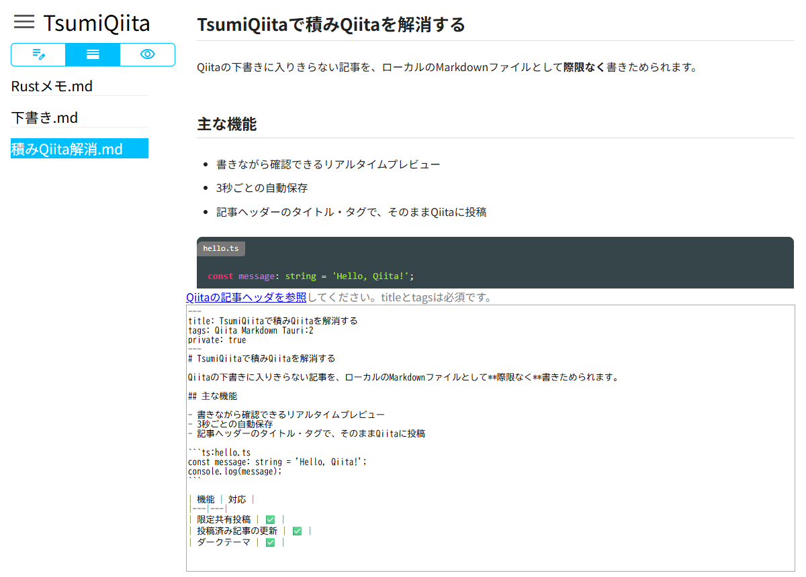

# TsumiQiitaとは

MarkdownファイルをQiitaに投稿するTauri製デスクトップアプリです。\
下書きに入りきらない**積みQiita**をするためにご利用ください。

bunとRustでビルドします。<wbr>**インストール方法は[INSTALL.md](INSTALL.md)**<wbr>を参照してください。

ビルド済みは[**こちら**](https://github.com/hidao80/TsumiQiita/releases)

## 主な機能

- 選択したファイルをQiitaに状態を指定して投稿（限定公開投稿可）
- 選択したMarkdownファイルをプレビュー
- PCのストレージから任意のMarkdownファイルを開く
- 新規Markdownファイルの作成
- Markdownで編集
- リアルタイムプレビュー
- Qiitaの[ノート記法（Note - 補足説明）](https://qiita.com/Qiita/items/c686397e4a0f4f11683d)（`:::note info` / `:::note warn` / `:::note alert`）をプレビューに表示
- 最後に編集してから3秒後に自動保存
- タグをつけて投稿
- 同一フォルダー内のMarkdownファイルをリストにして常時表示
- Windows / macOS / Linuxでほぼ同一のUIを提供
- twitter連携オプション可
- Qiita team用オプション可

以上の機能により、<wbr>**記事の草案をローカルに際限なく貯めることを可能にします**<wbr>。

### ユースケース

1. クラウドストレージにMarkdownファイルを保存し、任意の端末から編集して置いて本アプリで投稿する。
1. リアルタイムプレビューを見ながら下書きをする。

## セキュリティ

本アプリが対応しているセキュリティ対策は次のとおりです。

- **APIトークンの保管**: Qiitaのアクセストークンは設定ファイルに書かず、OSの資格情報ストアに保存します。
- **通信先の限定**: Qiita APIはアプリ本体（Rust）から`https://qiita.com/api/v2`だけを呼びます。トークンの保存時に、そのトークンが有効かをQiitaで確認します。
- **プレビューのスクリプト遮断**: 記事中のHTMLもプレビューしますが、CSP（Content Security Policy）で記事中のスクリプト（`<script>`やイベント属性）の実行を遮断します。
- **画面の権限の最小化**: 画面からファイルや通信を直接扱わず、アプリ本体のコマンド経由で操作します。コマンドの引数はアプリ本体で検証します（読み書きは`.md`ファイルのみ、記事IDは英数字のみ、未知の項目は拒否）。
- **外部リンク**: リンクはアプリ内で開かず、http/httpsのURLだけを既定のブラウザで開きます。アプリ外への画面遷移や新しいウィンドウは止めます。
- **依存パッケージの安全性**: インストール時にパッケージのスクリプトを実行せず（`ignoreScripts`）、公開から7日未満の版は入れません（`minimumReleaseAge`）。CIでは[Takumi Guard](https://github.com/flatt-security/setup-takumi-guard-npm)によるマルウェア検査と`bun audit`による脆弱性検査を行い、GitHub Actionsはコミットハッシュで固定しています。Dependabotのバージョン更新も、公開から7日未満の版は提案しません（`cooldown`）。

次の点は対象外です。

- 記事中の外部画像（https）はプレビュー時に読み込みます。画像の配信元にアクセスが記録される場合があります。
- 配布物にはコード署名・公証を行っていません（macOSはアドホック署名）。

## 注意

1. プレビューはQiitaやGitHubでの表示と異なります。あくまで参考程度とご理解ください。
1. 既存の記事とまったく同じ記事が投稿できます。上書きされません。

### Qiita記事のヘッダー書式

    ---
    title: 記事のタイトル
    tags: タグA:0.0.1 タグB
    tweet: false
    private: false
    coediting: false
    group_url_name: dev
    slide: false
    ---   
    # 見出し1
    本文...

フィールド | 必須 | Type | 説明
---|---|---|---
title | 〇 | string | 記事のタイトル（`"..."` で囲んでも可。`:` を含めても切り捨てられません）
tags | 〇 | string/list | タグ。バージョン併記可（`タグ:1.0`）。5つまで。`タグA タグB`・`[タグA, タグB]`・Qiita CLIと同じブロック形式（次行以降に `  - タグ`）に対応
tweet | | true/false | Twitterに投稿するかどうか (Twitter連携を有効化している場合のみ有効。新規投稿時のみ送信)
private | | true/false | 限定共有状態かどうかを表すフラグ (Qiita Teamでは無効)  
coediting | | true/false | この記事が共同更新状態かどうか (Qiita Teamでのみ有効)
group_url_name | | null/string | この投稿を公開するグループの url_name (null で全体に公開。Qiita Teamでのみ有効)
organization_url_name | | null/string | 記事を関連付けるOrganizationの url_name
slide | | true/false | スライドモードを有効にするかどうか
posting_campaign_uuid | | null/string | 登録する記事投稿キャンペーンのUUID（指定時は `agreed_posting_campaign_term: true` が必須）
agreed_posting_campaign_term | | true/false | 記事投稿キャンペーンの規約に同意するかどうか
id | | null/string | 投稿済み記事のID。新規投稿に成功すると自動で書き込まれ、以降の投稿はこの記事の更新になります（消すと新規投稿）
ignorePublish | | true/false | true の記事は投稿しません（Qiita CLIと同じ）

`null` を指定した項目は送信しません（そのため、PATCHで投稿キャンペーンの登録を解除する操作には対応していません）。

### TODO

- [x] ~~同期スクロールでプレビューが一番下まで表示されない~~
- [x] ~~対象フォルダー選択~~
- [x] ~~Markdownファイル選択~~
- [x] ~~Markdownファイルプレビュー~~
- [x] ~~プレビュー中のファイルをQiitaへ限定公開として投稿する~~
- [x] ~~編集~~
- [x] ~~新ファイル作成~~
- [x] ~~Qiita風CSS適用~~
- [x] ~~最後に編集してから3秒後に自動保存する~~
- [x] ~~タグを登録できる~~
- [x] ~~シンタックスハイライトに対応~~
- [x] ~~CommonMarkdown に作表と打ち消し線、チェックボックス表示機能を追加~~
- [x] ~~Qiita風のコードブロック（ファイル名表示機能付）~~
- [x] ~~投稿できない~~
- [x] ~~Electron最新版でapp.makeSingleInstanceが動かない（requestSingleInstanceLockに移行）~~
- [x] ~~Electron最新版でnodeIntegrationがデフォルトfalseになりrequireが使えない（webPreferencesで有効化）~~
- [x] ~~Electron 14以降electron.remoteが廃止され動かない（ipcMain/ipcRendererに移行）~~